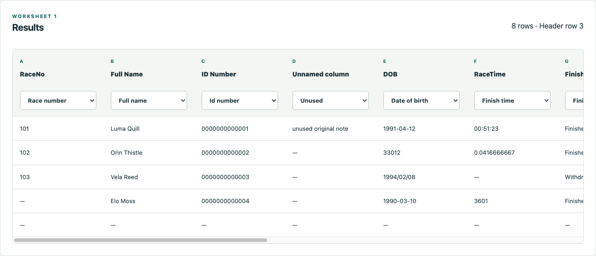
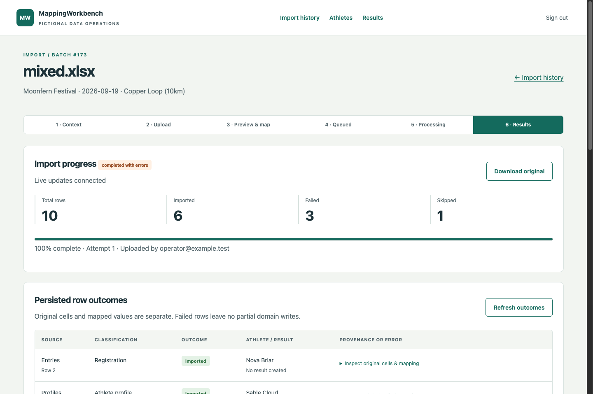

# MappingWorkbench

A spreadsheet import becomes a reconciliation problem when one workbook mixes race results, registrations and athlete profiles, later uploads correct existing results, and one invalid row must not discard everyone else's data.

MappingWorkbench is a standalone Rails application for that problem. Operators select event/race context, inspect every XLSX worksheet, correct headers, map 17 destinations, queue a background import and inspect live progress, relational results and original row provenance. All included people, identifiers, clubs and events are fictional.

The public `main` branch intentionally contains the initial runnable scaffold. The complete application is on `feat/complete-importer` in an open review PR; it has not been merged or deployed.



## Run locally

Install Ruby **4.0.7**, Docker Compose and Chrome (for browser tests). The Ruby gems are pinned in `Gemfile` and the fresh lockfile. PostgreSQL **17.11** and Redis **7.2.13** are pinned in Compose.

```sh
git clone --branch feat/complete-importer https://github.com/HansieMuller/mapping-workbench.git
cd mapping-workbench
docker compose -p mapping-workbench up -d --wait
export MW_DATABASE_PORT=5547
export MW_DATABASE_USER=postgres
bundle install
bin/setup
bin/dev
```

Run `bin/worker` in a second terminal with the same two database environment variables. Open [localhost:3000](http://localhost:3000). Sign in as `operator@example.test`; read the generated password from `tmp/demo_password` locally. The password is random, stored with mode 0600 and ignored by Git. Do not paste it into logs, screenshots or a public issue.

With a native local PostgreSQL installation, omit `MW_DATABASE_PORT`, and set `MW_DATABASE_USER` to your local role. Keep the isolated Redis service on port 6387. Do not set `DATABASE_URL`: the app rejects it to avoid silently connecting this demo to another database.

Both services and the web server bind to localhost. The dedicated databases are `mapping_workbench_development` and `mapping_workbench_test`; Redis database 0 is development and database 1 is testing. No paid account or external credential is needed.

## Demonstrate in five minutes

1. **0:00–1:00:** Sign in, click **New import**, select Moonfern Trail Festival / Copper Loop, and upload `test/fixtures/files/mixed.xlsx`.
2. **1:00–2:00:** Inspect all three sheets. Results uses header row 3; column D is unnamed and unused. Profiles keeps columns through AB. Inspect header candidates and change a row if necessary. Every sheet has its own mapping selectors.
3. **2:00–3:00:** Confirm mappings. A separate Sidekiq worker processes rows against PostgreSQL. The page receives authenticated ActionCable updates and moves to persisted outcomes.
4. **3:00–4:00:** Observe **6 imported, 3 failed, 1 skipped**. Four results and six athletes exist. Profile/registration rows created athletes without results. Inspect an error and original cells, then open Athletes and Results.
5. **4:00–5:00:** Upload `updates.xlsx` into the same race. Race number 101 changes from `00:51:23` to `00:49:01`, retaining its creating batch. Upload `conflict.xlsx` to see conflicting identity/race-number rows rejected. Explain resume using the backend-loss and interrupted-job tests.

Use `success.xlsx` for 6 imported / 2 skipped with no row errors. Generate the fictional examples again with `bundle exec ruby script/generate_workbooks.rb`; no original workbook is used.



## Verification

Run the complete local CI campaign with the same database environment variables:

```sh
bin/ci
```

It runs PostgreSQL tests and competing-session regressions, Chrome system tests with a separate real Redis/Sidekiq worker, autoload checks, RuboCop, Brakeman, gem and JavaScript dependency audits, and publication checks. Chrome screenshots are written to ignored `tmp/screenshots`. GitHub Actions runs the same command on `main` and pull requests, with pinned PostgreSQL and Redis services.

See [verification evidence](docs/evidence.md), [feature parity](docs/parity.md), [architecture](docs/architecture.md), [mapping and identity rules](docs/rules.md), and the [changelog](CHANGELOG.md).

## Reset and stop

Stop the web server and worker first, then run:

```sh
bin/reset --confirm
docker compose -p mapping-workbench stop
```

Reset purges uploaded files, clears this isolated demo's queues and rebuilds its development database, including raw provenance and audit history. It refuses other database names, non-development environments and active workers. Re-running `bin/setup` preserves the existing operator; after reset the password file contains a new random password. `docker compose ... stop` preserves volumes. Remove only this Compose project's volumes if you explicitly want to discard them.

## Interview reading path

- [`WorkbookGuard`](app/services/importer/workbook_guard.rb) and [`WorkbookPreview`](app/services/importer/workbook_preview.rb): bounded archive inspection, relationship validation, conservative header suggestions and correctable previews.
- [`MappingValidator`](app/services/importer/mapping_validator.rb), [`RowData`](app/services/importer/row_data.rb) and [`RowClassifier`](app/services/importer/row_classifier.rb): trusted server mapping, typed provenance and row classification.
- [`AthleteResolver`](app/services/importer/athlete_resolver.rb) and [`RaceResultWriter`](app/services/importer/race_result_writer.rb): identity precedence, conflict rejection, fill-missing-only profiles, memberships and distinct result keys.
- [`DatabaseLock`](app/services/importer/database_lock.rb), [`WorkbookImporter`](app/services/importer/workbook_importer.rb) and [`ImportBatch`](app/models/import_batch.rb): session/claim fencing, row savepoints, durable counters and checkpoint replay.
- [`ImportWorkbookJob`](app/jobs/import_workbook_job.rb), [`ImportBatchChannel`](app/channels/import_batch_channel.rb), and [PostgreSQL concurrency tests](test/services/importer/postgresql_concurrency_test.rb): audit attribution, private progress and real transaction evidence.

## Limits and provenance

This is a local portfolio demonstration. There is no production deployment, scale claim, multitenancy, billing or generic transformation language. Public deployment would need a separate security review, TLS, restricted service access, managed credentials, operational monitoring, worker supervision, backups and retention policy. All authenticated operators share the fictional athlete/result domain; batches, uploads and provenance are private to their uploader.

It is an authorized derivative of an existing importer, rebuilt with fresh Git history. No private source links/excerpts, customer records, original workbooks, branding, credentials or production configuration are published. The derivative's redistribution license has not been independently established, so this repository makes no additional licensing or exclusive-authorship claim. Third-party packages retain their licenses.

Built with Rails and open-source libraries; Codex assisted implementation, review and verification.
