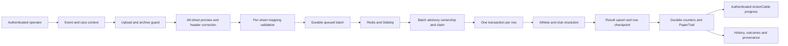

# Architecture and data flow

The application is server-rendered Rails, with Active Storage on local disk, Roo for typed XLSX reading, PostgreSQL for relational state, open-source Sidekiq/Redis for jobs, Stimulus/Turbo for interaction and PaperTrail for audit attribution.

## Domain

An event has dated races. Every batch belongs to an uploader, event and race. A composite PostgreSQL foreign key enforces the selected race/event relationship, alongside Rails validation. All imported results target the batch-selected race.

Athletes have memberships in normalized clubs and results in races. Import rows link the batch to their resolved athlete/result, with unique `(batch, sheet, source row)` checkpoints. Results keep their creating batch; later contributing rows remain separately traceable. PaperTrail versions cover event/race, athlete, batch and result changes. Background versions carry `User:<uploader id>`.

## Ownership and transactions

A PostgreSQL session advisory lock claims one batch. A duplicate job that cannot acquire it exits without changing counters or state. Under that ownership, a queued batch gets a persisted claim token and attempt number.

Every row/counter/terminal write checks the original database backend PID and persisted claim while holding the batch row lock. `FOR NO KEY UPDATE` serializes batch state changes while permitting foreign-key references to that batch. These checks matter because Rails can reconnect after a failed backend; the replacement connection does not own the old advisory lock. A stale worker must stop without changing its replacement's data or failure state.

Within the row transaction, provenance persists, domain work executes in a savepoint and the imported checkpoint commits with the athlete/membership/result writes. A known validation/identity failure rolls back domain work and persists the failed row. Uniqueness retries re-enter the entire domain row only after the savepoint has rolled back. They never retry SQL inside an aborted transaction. Earlier successful rows survive subsequent failures.

Identity decisions use one short transaction advisory lock in this small demo. Strong identifiers, weak identity keys, normalized clubs, memberships and result keys also have unique database constraints. The global identity lock is deliberately simple and reduces throughput; it is not a claim of high-scale import performance. No external network operation occurs under these transactions.

## Durability and recovery

`pending_mapping → queued → processing → completed / completed_with_errors` is the normal lifecycle. Unexpected infrastructure interruption becomes `failed` where the original ownership remains valid. Abrupt process/database-session loss can leave `processing` persisted; a stale disconnected worker does not write a misleading terminal state.

Counters are derived from persisted row statuses, so they can briefly lag a commit but recover on resume. Source-row checkpoints are immutable on replay: imported, failed and skipped rows are retained; only absent/pending rows are processed. Failed business rows need a corrected new workbook, not a retry of committed failures. Explicit **Resume interrupted import** first proves the session advisory lock is available and queues uncommitted work. An active worker blocks resume without guessing from a timer.

The durable queue-state update precedes Redis delivery. A crash or Redis failure in that gap can leave a queued batch with no delivery; resume repairs it. Duplicate delivery is safe while ownership exists and terminal batches are ignored. Sidekiq's open-source delivery is not an exactly-once guarantee; a lost in-progress fetch after worker death requires explicit resume. There is no distributed transaction between PostgreSQL and Redis.

Progress payloads contain aggregate state rather than raw rows. Each subscription verifies batch ownership and transmits durable state. The browser reads another snapshot after subscription confirmation to cover missed startup/reconnect publications. Received terminal state replaces stale mapping/recovery screens. Downloads use owner-scoped controller actions; default Active Storage routes are disabled.

## Operations and storage

Uploaded workbooks and unused raw cells remain local and private. That retention helps explain failures but is not data minimization; use fictional data and the documented reset workflow. Logs filter uploads, mapping/provenance, credentials and serialized version objects. The generated password stays outside tracked source.

Compose services and Puma bind to localhost. Database names and Redis port/databases are restricted for this demo. There is no deployed app or production connector.
